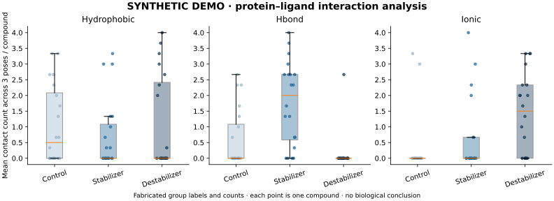

# Protein–Ligand Stability Analysis

**Protein–ligand data analysis for pharmacological-chaperone research**

**Juliana Rivera Camacho · M.Sc. Molecular Life Sciences · Universität Hamburg**  
**Research setting:** Universitätsklinikum Hamburg-Eppendorf (UKE) · Research lab rotation

Python notebooks for investigating protein stability and protein–ligand interaction patterns in a research project involving **phenylalanine hydroxylase (PAH)** and **glutaryl-CoA dehydrogenase (GCDH)**. The original research focused primarily on PAH. The runnable public demo uses fabricated counts only.

The project explores computational patterns that may help explain differences between compound groups associated with protein stabilization, destabilization or no effect. It supports pharmacological-chaperone research through data processing, structural analysis and scientific visualization.

## Scientific motivation

Small molecules that stabilize a protein are potential starting points for pharmacological-chaperone research. Understanding their predicted binding environments and interaction patterns can help generate hypotheses for experimental follow-up.

This repository focuses on **analysis of processed research inputs**. It does not establish that a docking pose is a verified binding site, or that a compound restores enzyme activity.

## Project at a glance

| Research focus | Approach | Relevance to discovery research |
| --- | --- | --- |
| Protein stability | Visualization of supplied predicted variant effects using explicit input positions | Relating variant positions to protein context |
| Structural analysis | Residue-level pocket mapping and comparison of docking poses | Examining predicted ligand environments |
| Protein–ligand interactions | Processing interaction profiles into residue-by-feature matrices | Characterizing non-covalent interaction patterns |
| Data analysis | Compound-level aggregation, group comparisons and exploratory contingency-table analysis | Exploring compound-group differences |
| Communication | Heatmaps, interaction maps and distribution plots for scientific interpretation | Communicating structural-analysis findings |

## My contribution

- **Data processing:** processed supplied protein and ligand data for analysis.
- **Structural analysis:** mapped residue-level patterns and compared docking poses.
- **Feature analysis:** summarized interaction features across compounds and poses.
- **Exploratory statistics:** investigated differences between compound groups.
- **Scientific communication:** developed visualization notebooks and research figures.

## Approach and workflow

1. **Explore variant stability:** reshape supplied mutation-effect predictions into heatmaps using explicit input positions.
2. **Map ligand environments:** prepare protein–ligand complexes and extract nearby residues.
3. **Compare poses:** build residue-presence matrices for selected docking poses and summarize contact frequencies.
4. **Characterize interactions:** extract and visualize interaction classes using the supplied structural helper functions.
5. **Summarize compounds:** harmonize interaction features, aggregate counts and compare distributions across compound groups.
6. **Explore associations:** construct contingency tables to investigate interaction-pattern differences.

## Technical stack

**Python · pandas · NumPy · Matplotlib · Seaborn · SciPy · RDKit · Biopython · PyMOL · PLIP · Open Babel**

These tools support tabular processing, structural file handling, interaction characterization and scientific visualization. The project analyzes supplied predictions and docking outputs; it does not train a new protein foundation model.

## Evidence and interpretation

- Residue proximity and docking-derived interactions are computational hypotheses, not experimental binding evidence.
- Pose-level measurements for the same compound are related observations; they should not be treated as independent biological replicates.
- Interaction counts depend on pose selection, processing settings and aggregation choices.
- The revised statistical workflow uses a fixed presence rule, compound-level Fisher tests and Benjamini–Yekutieli adjustment across the planned test family. Historical threshold-scanned results require reanalysis.
- Missing raw inputs prevent an independent end-to-end reproduction from this repository alone.

## Runnable example

[Run the synthetic analysis](examples/synthetic/README.md):

```bash
python -m pip install -r requirements-demo.txt
python examples/synthetic/run_demo.py
python -m unittest discover -s tests -v
```

It generates 60 fabricated compounds with three poses each, validates inputs, summarizes at compound level and exports a figure and complete statistical tables. No patient or unpublished research inputs are required.



**Synthetic demonstration only:** group differences are deliberately generated and support no biological conclusion. See the example guide for assumptions and outputs.

## Repository guide

| Notebook | Purpose |
| --- | --- |
| [01 — Variant stability](notebooks/01_thermompnn_variants.ipynb) | Validated prediction-table loading and ΔΔG heatmap |
| [02 — Ligand pockets](notebooks/02_protein_ligand_pocket.ipynb) | Pocket-residue extraction and ligand-by-residue visualization |
| [03 — Docking poses](notebooks/03_protein_ligand_by_poses.ipynb) | Pose-specific residue mapping and contact-frequency summaries |
| [04 — Interaction extraction](notebooks/04_ligand_molecular_interactions.ipynb) | Protein–ligand interaction processing |
| [05 — Interaction maps](notebooks/05_ligand_molecular_interactions_figure.ipynb) | Interaction-type matrices and color-coded residue maps |
| [06 — Compound summaries](notebooks/06_compound_interaction_summary.ipynb) | Interaction aggregation and violin/strip plots |
| [07 — Exploratory statistics](notebooks/07_compound_interaction_statistics.ipynb) | Fixed-rule compound-level Fisher tests, effect sizes and BY adjustment |

[Structural helper module](notebooks/src/generate_graph_new.py) contains complex preparation, pocket and interaction functions. The `archive/learning/` folder contains early learning and prototype notebooks; start with the numbered analysis notebooks above.

### Reproducing the analyses

The public synthetic demo runs with no institutional inputs. Research notebooks use a local configuration file and explicit compound/pose identifiers; structural stages require authorized prepared complexes and optional dependencies.

Read [the workflow and reproducibility guide](docs/WORKFLOW.md) before execution. It documents input expectations, dependencies and important interpretation checks. A tested pinned environment is supplied for the synthetic demo. Structural dependencies have not been validated together here.

## Research context and collaboration

The notebooks use supporting structural-analysis functions attributed in their comments to **PD Dr. Behnam Yousefi**, including protein–ligand complex preparation, pocket extraction and interaction analysis. My contribution centers on the downstream data-analysis workflows and scientific figures; the repository should be read with these contributions distinguished.

Developed during a research lab rotation involving protein stability and pharmacological-chaperone discovery. Please acknowledge the author and the contributions of collaborators when discussing or reusing this work. No peer-reviewed publication or experimentally validated therapeutic outcome is claimed here.

**Juliana Rivera Camacho** · Hamburg, Germany  
[GitHub profile](https://github.com/julianariveracamacho)

